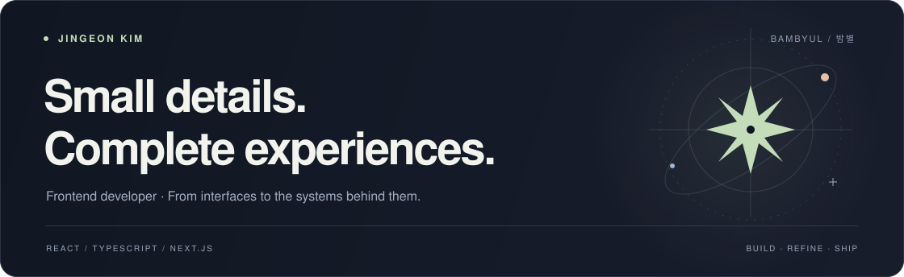

  <a href="https://blog.bambyul.com/ko">Writing</a> &nbsp; / &nbsp;
  <a href="https://game.bambyul.com/ko">Game Mate</a> &nbsp; / &nbsp;
  <a href="https://contest.bambyul.com">별사대</a>

  <strong>복잡한 흐름을 명확한 인터페이스로 만듭니다.</strong> 
  프론트엔드를 중심으로, 화면 뒤의 API와 데이터, 배포까지 연결합니다. 
  만들면서 겪은 문제와 선택한 이유는 <a href="https://blog.bambyul.com/ko">밤별 블로그</a>에 기록합니다.

 

### Selected work

<table>
  <tr>
    <td width="50%" valign="top">
      
      
함께 게임할 사람을 찾고, 피드백과 코칭을 나누는 서비스. 게시글에서 시작한 대화를 1:1 채팅으로 이어 갑니다.

      
Next.js · NestJS REST · PostgreSQL · Expo

      <a href="https://game.bambyul.com/ko">서비스 ↗</a> &nbsp; · &nbsp;
      <a href="https://github.com/jingeon27/side-project/tree/develop/projects/game-feedback">코드와 설계 ↗</a>
    </td>
    <td width="50%" valign="top">
      
      
사진과 일상을 함께 모으는 그룹 커뮤니티. 공개·비공개 그룹 안에서 사진을 나누고, 대회를 열어 투표합니다.

      
Next.js · NestJS GraphQL · PostgreSQL · Expo

      <a href="https://contest.bambyul.com">서비스 ↗</a> &nbsp; · &nbsp;
      <a href="https://github.com/jingeon27/side-project/tree/develop/projects/photo-contest">코드와 설계 ↗</a>
    </td>
  </tr>
</table>

### How I think

- **상태의 주인을 분명하게.** 서버 데이터와 작성 중인 폼의 역할을 나눕니다. [예약 폼을 정리한 과정 ↗](https://blog.bambyul.com/ko/blog/예약-폼의-작성-상태를-zustand에서-react-hook-form으로-옮긴-과정)
- **타입은 호출부를 위해.** 잘못된 조합을 줄이고, 의도가 읽히는 인터페이스를 고민합니다. [TypeScript 패턴 ↗](https://blog.bambyul.com/ko/blog/실무에서-자주-쓰는-typescript-패턴-네-가지)
- **화면 이후까지 확인하기.** 오류 수집과 배포, 복구도 서비스의 일부로 다룹니다. [기술을 선택한 기준 ↗](https://blog.bambyul.com/ko/blog/두-사이드-프로젝트에서-기술을-선택한-기준)

### Open source

**[toss/slash](https://github.com/toss/slash/pull/363)** · Merged contribution 
`use-funnel`의 `NonEmptyArray` 타입 혼동을 줄이고, 기존 추론을 유지하는 `StepType`으로 정리했습니다.

 

**Mostly** &nbsp; TypeScript · React · Next.js · TanStack Query · React Hook Form 
**Also building with** &nbsp; NestJS · PostgreSQL · AWS · Expo · Playwright

---

밤별 · Bambyul — 이름에 담긴 ‘별’과 ‘하늘’에서 시작한, 만들고 기록하는 공간.
